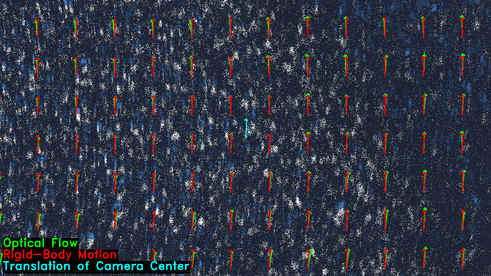
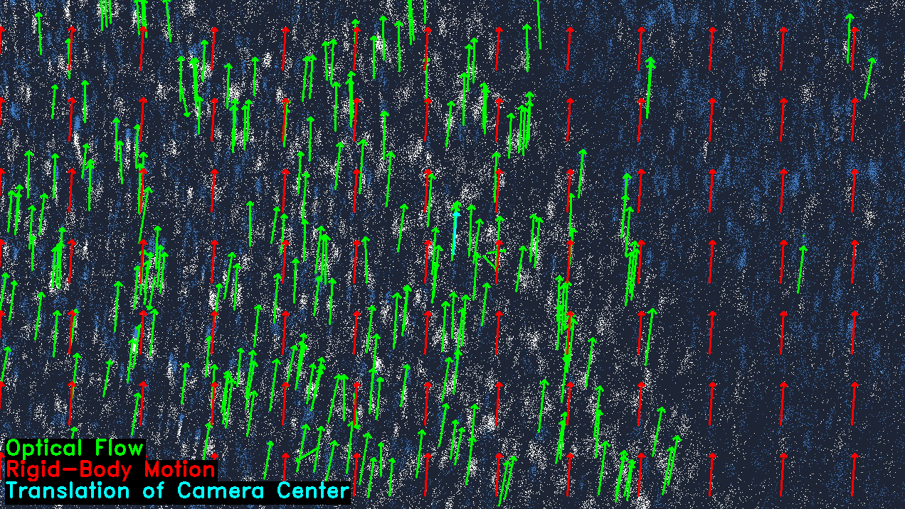

# EV-Flow-Vel: Planar Velocity Estimation for Fast-Moving Mobile Robots Using Event-Based Optical Flow
This is the official implementation of our 2025 RA-L paper [Planar Velocity Estimation for Fast-Moving Mobile Robots Using Event-Based Optical Flow](https://ieeexplore.ieee.org/stamp/stamp.jsp?arnumber=11021382).


## Getting started
To get going you can setup a conda environment with:
```bash
conda env create -f environment.yaml
```

and launch the environment with:
```bash
conda activate evflowvel
```

## Run the demo
If you have a video you can run the velocity estimation like this:

```bash
python demo.py --flow-algo "<farneback/lukas-kanade>" --video-path "<path/to/your/video>" --delta-t "<time between frames>" --camera-focal-length "<your focal length>" --camera-height "<your height>"
```

Optionally you can also run the code with RANSAC by setting ```--use-ransac True``` and you can set a region of interest with ```--roi left top right bottom```.

When running the code with Farneback, a dense flow estimator, the output will look like the following image:



where the green arrows represent the estimated optical flow, the red arrows show the estimated rigid body motion of the ground with respect to the camera, and the blue arrow indicates the translation of the ground with respect to the camera center.
For a sparse optical flow algorithm, like Lukas-Kanade, the output will look like the following image:



## Citation
```
@ARTICLE{ev-flow-vel,
  author={Boyle, Liam and Kühne, Jonas and Baumann, Nicolas and Bastuck, Niklas and Magno, Michele},
  journal={IEEE Robotics and Automation Letters}, 
  title={Planar Velocity Estimation for Fast-Moving Mobile Robots Using Event-Based Optical Flow}, 
  year={2025},
  volume={10},
  number={7},
  pages={7318-7325},
  keywords={Cameras;Estimation;Robot sensing systems;Wheels;Odometry;Accuracy;Velocity measurement;Optical flow;Roads;Event detection;Advanced driver assistance systems;optical flow;state estimation;velocity measurement;visual odometry},
  doi={10.1109/LRA.2025.3576070}}

```